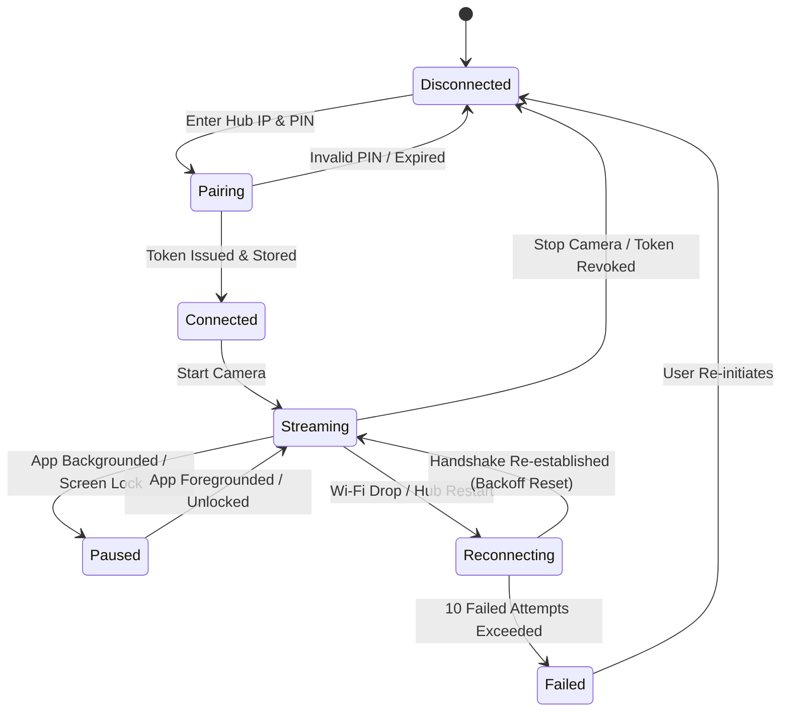

# Android Camera Application Release Guide

This document describes the architecture, permissions, lifecycle state machine, and release build procedures for the Smart Spectator Android Camera application (`apps/camera`).

---

## 1. Permission Matrix & Privacy Rationale

Smart Spectator strictly limits permissions to local operational needs:

| Permission | Rationale | Security / Privacy Guard |
| :--- | :--- | :--- |
| `android.permission.CAMERA` | Captures local video frames for transmission to the Hub. | Camera hardware is released immediately when the app is backgrounded or screen locked. |
| `android.permission.INTERNET` | Transmits video packets to the local Hub IP via LAN sockets. | No traffic is routed to external cloud services or public internet endpoints. |
| `android.permission.ACCESS_NETWORK_STATE` | Detects LAN / Wi-Fi connectivity changes. | Used to trigger graceful reconnect state machine when Wi-Fi drops. |
| `android.permission.ACCESS_WIFI_STATE` | Reads local network subnet parameters. | Enables automatic mDNS Hub resolution on local Wi-Fi. |
| `android.permission.CHANGE_WIFI_MULTICAST_STATE`| Listens for mDNS zero-conf beacons (`_smartspectator._tcp.local.`). | Enables automatic Hub discovery without manual IP entry. |
| `android.permission.WAKE_LOCK` | Prevents CPU sleep while actively streaming in foreground. | Discharged immediately upon operator tapping "Stop Streaming". |

*No location, contacts, storage, or microphone permissions are requested.*

---

## 2. Camera & Network Lifecycle State Machine

The Android application implements strict resilience mechanisms:



- **Exponential Backoff**: If network or Hub connection drops, reconnect attempts back off at 1s, 2s, 4s, 8s, 16s, max 30s up to 10 attempts. Successful handshake resets attempt count to zero.
- **Hardware Lockup Prevention**: `WidgetsBindingObserver` listens for `AppLifecycleState.paused` / `inactive` and immediately disposes the `CameraController` to prevent native Camera2 HAL daemon deadlocks. When resumed, controller is re-initialized cleanly.
- **Honest Telemetry**: Battery and thermal reporting returns real device metrics or `null` if hardware thermal APIs are unavailable on the device.

---

## 3. Building Release Artifacts

### 3.1 Prerequisites
- Flutter SDK 3.19+ (Dart 3.3+)
- Android SDK 34 (Android 14)
- Java 17 Development Kit (OpenJDK 17)

### 3.2 Build Release APK
```bash
cd apps/camera

# Fetch dependencies
flutter pub get

# Build universal release APK
flutter build apk --release

# Output path:
# build/app/outputs/flutter-apk/app-release.apk
```

### 3.3 Build Split-per-ABI APKs (Smaller Footprint)
```bash
flutter build apk --release --split-per-abi

# Generates:
# - app-armeabi-v7a-release.apk (Legacy 32-bit ARM)
# - app-arm64-v8a-release.apk   (Modern 64-bit ARM, optimal for Snapdragon)
# - app-x86_64-release.apk      (Emulators / test devices)
```

### 3.4 Build Android App Bundle (AAB)
```bash
flutter build appbundle --release

# Output path:
# build/app/outputs/bundle/release/app-release.aab
```

---

## 4. Device Installation & Verification

1. Enable **Developer Options** and **USB Debugging** on the Android smartphone.
2. Connect phone via USB and verify ADB connection:
   ```bash
   adb devices
   ```
3. Install the release APK:
   ```bash
   adb install -r build/app/outputs/flutter-apk/app-release.apk
   ```
4. Launch "Smart Spectator Camera", verify camera preview opens smoothly, and confirm local Hub discovery or direct IP connection.
