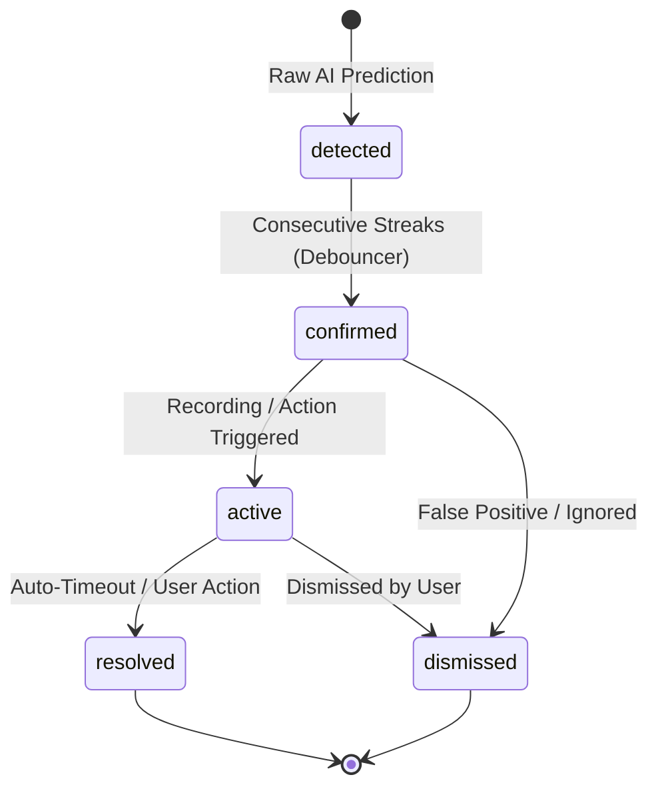

# Event Engine Architecture & Deep Dive Specification
## Smart Spectator Core Intelligence Layer

---

### 1. Purpose & Scope

The `EventEngine` is the central orchestration hub of Smart Spectator. It consumes probabilistic AI predictions from Phase 3 (`EventPrediction`) and geometric tracking data from Phase 2 (`Observation`), applying temporal filtering, spatial constraints, and business logic to emit structured, auditable events.

---

### 2. Concurrency & Threading Model

```
                         [ AI Pipeline Thread ]
                                   |
                                   v  enqueue (blocking / bounded)
                      +-------------------------+
                      | _prediction_queue       | (Max 256 items)
                      | _observation_queue      | (Max 256 items)
                      +-------------------------+
                                   |
                                   v  dequeue
                         [ EventEngine Worker ]
                                   |
             +---------------------+---------------------+
             |                     |                     |
             v                     v                     v
     Confidence Filter      Cooldown Manager     Debouncer & State
             |                     |                     |
             +---------------------+---------------------+
                                   |
                         [ Confirmed Event ]
                                   |
             +---------------------+---------------------+
             |                     |                     |
             v                     v                     v
     SQLite Write Pool      Recording Trigger    WebSocket Broadcast
```

- **Dedicated Worker Thread:** Processing runs in an isolated daemon thread (`_worker_loop`) decoupling AI inference and frame ingestion from event logic.
- **Bounded Queues:** Prediction and observation queues are bounded to 256 items with non-blocking enqueue drop or oldest eviction to eliminate memory leakage under heavy load.
- **Background Resolution Sweeper:** A periodic timer sweeps for active events that have exceeded their absence timeout, automatically transitioning them to `resolved`.

---

### 3. State Lifecycle & Transitions



#### State Transition Rules
1. `detected` $\rightarrow$ `confirmed`: Fired when `streak >= consecutive_frames` in the `TemporalDebouncer`.
2. `confirmed` $\rightarrow$ `active`: Transitions immediately once actions (e.g. recording) are initiated.
3. `active` $\rightarrow$ `resolved`: Occurs automatically when no positive detections occur within `resolution_timeout_seconds` (default: 10s) or upon operator manual resolution.
4. `confirmed` / `active` $\rightarrow$ `dismissed`: Operator marks the alert as ignorable; actions are cancelled.
5. All other transitions raise `InvalidStateTransitionError`.

---

### 4. Cooldown & Deduplication

- **Camera-Level Cooldown:** Suppresses new events of the same type on the same camera for `cooldown_seconds` (default: 10.0s).
- **Rule-Level Cooldown:** Per-rule cooldown tracking allows fine-grained rate limiting (e.g. 60s between email/desktop alerts).
- **Prediction Aggregator:** Maintains a sliding correlation window (default: 3.0s). When multiple predictions for an active event arrive, it aggregates track IDs, updates end timestamps, and retains peak confidence.

---

### 5. Confidence Thresholds

Configured in `services/event_engine/confidence.py`:

| Event Type | Default Min Confidence | Rationale |
|---|---|---|
| `PERSON_ENTERED` | 0.70 | Balances fast detection with low false alarms |
| `PERSON_LEFT` | 0.70 | Matches entry criteria |
| `OBJECT_PRESENT` | 0.65 | Permits detection of partially occluded items |
| `OBJECT_REMOVED` | 0.70 | Critical security event, requires strong certainty |
| `OBJECT_MOVED` | 0.65 | High sensitivity to subtle shifts |
| `ZONE_LOITERING` | 0.75 | Requires clear track stability |
| `CAMERA_BLOCKED` | 0.80 | High threshold to prevent false camera fault alerts |
| `TASK_COMPLETED` | 0.70 | General activity threshold |

Thresholds can be dynamically adjusted via REST API or configuration without restarting the engine.
